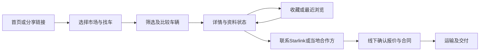

# MYUCAR 网站走查与 Starlink 独立站复原方案

日期：2026年11月16日。状态：公开前台核心页面走查完成；Starlink方案为建议，待结合公司资料确认。参考：[MYUCAR中文站](https://www.myucar.com/zh)。本次未开发或部署网站。

## 1. 结论

这个网站适合作为 Starlink 汽车销售独立站的结构与交互参考。核心价值是让海外买家快速找车、看清车况与报价、找到负责该市场的联系人。网站视觉比较克制，以车辆照片和筛选效率为主，适合在保留整体布局的基础上换成 Starlink 品牌。

建议高保真复原首页、车辆卡片、筛选列表、详情图集、收藏及联系入口；公司介绍、车源、服务市场、价格口径和联系人全部使用 Starlink 自有资料。网站公开前台主要承接咨询，商务页明确报价、合同、付款与交付线下确认。本次走查未发现需要纳入首版的在线支付路径，不能因此断言它没有内部交易系统。

“尽量复原”可以落实到模块顺序、尺寸比例、配色关系、卡片密度、筛选及选车流程。它不意味着导入对方库存、把对方业绩改成我们的业绩，或把未观察到的后台自动列为既定范围。参考站App、物流查询、代理网络应按Starlink实际运营条件确定是否保留。

## 2. 页面地图与迁移建议

| 页面 | 实际观察 | Starlink建议 |
| --- | --- | --- |
| 首页 `/zh` | 促销大图、业务数字、搜索、热门品牌、推荐车、最新车、信任理由、合作入口 | 保留层级；首屏换为自有业务主张与车辆／交付图；无依据的数字模块先不展示 |
| 车源 `/zh/vehicles` | 左侧筛选，右侧搜索／排序／结果卡片；手机改筛选弹层 | 核心必做；独立URL支持分享与返回 |
| 详情 `/zh/vehicles/{slug}` | 图集、车型配置、报价／运费、联系人、参数、车况、配置、资料状态 | 核心必做；明确车辆编号和售卖状态 |
| 收藏 `/zh/favorites` | 收藏与最近浏览两栏；说明仅保存在当前浏览器 | 可以复原；无需为了收藏先增加账户体系 |
| 代理 `/zh/agents` | 合作方目录、类型／语言／服务／渠道筛选、营业状态、联系方式 | 有真实代理网络时保留；仅自营团队时先做联系页 |
| 关于 `/zh/about` | 公司定位、出口服务、采购核验→检测→出口准备→代理交付 | 按真实服务链重写，可补真实办公／交付照片 |
| 商务 `/zh/contact` | 按市场显示客服，电话／邮箱／WhatsApp等外链 | 核心必做；按用户所在市场准确分流 |
| 物流 `/zh/logistics` | 合同号输入与查询按钮 | 有真实数据与访问规则后实现；不能只放一个无结果的查询框 |
| 下载 `/zh/download` | 产品介绍、界面预览、iOS／Android、二维码及商店入口 | 无自有App时不放虚假下载；可取消此导航或换成服务流程 |
| 价格说明、隐私、条款 | 三个独立页脚入口；价格说明中文入口回退英文 | 按Starlink实际数据与交易方式编写，补齐首发语言 |

页面路径是参考站实际路径，Starlink可采用相同清晰层级，但语言前缀、品牌文案和内容独立维护。[参考页面](https://www.myucar.com/zh/vehicles)、[公司介绍](https://www.myucar.com/zh/about)、[联系页](https://www.myucar.com/zh/contact)。

## 3. 首页与视觉拆解

首页模块顺序：

1. 顶栏：Logo／品牌名，首页、车源、车商代理、关于、下载，收藏图标，语言、市场、币种，突出商务按钮。
2. 首屏：全宽汽车主题大图，左侧小标签、大标题、说明和选车按钮；底部金棕色细线。
3. 业务数字：三个简短指标，承担信任背书。数字为参考站自身声明，本次未核验。
4. 搜索卡：关键词、品牌、能源、价格上下限、日期范围、搜索按钮；桌面为三列两排。
5. 热门品牌：快速进入对应品牌结果；初始全球市场显示品牌数量。
6. 推荐及最新车源：重复使用统一车辆卡，区分精选与上新动机。
7. 信任说明：车源核验、出口准备、当地支持、资料透明。
8. 商务合作与多列页脚：为车商、代理和其他合作方提供另一条入口。

桌面实测视口为1440×1000，列表有约280px筛选侧栏，右侧四列车卡；页面主体浅灰蓝、卡片白色、深海军蓝主文字和主要按钮、金棕色商务按钮、绿色出口／运费提示。细边框、小阴影、中等圆角，车辆图像占卡片上半部。这里的尺寸与颜色为截图观察和实现参考，并非对方CSS精确数值。

可先采用以下设计参数作为复原起点，再用截图校准：主色约 `#1D2540`、强调色约 `#955A16`、背景约 `#F1F6F9`；卡片圆角12～16px；正文14～16px；常规按钮44～48px高；布局间距16／24／32／48px。最终品牌色以Starlink资料为准。

手机390×844下：Logo、收藏、菜单一行；导航展开后占据首屏较大高度；收起后首屏图片、标题和按钮纵向显示；首页搜索改为单列；车源列表提供“筛选”按钮并打开dialog，内含清除和结果按钮。本次导航在进入部分页面时呈展开状态，应在我们实现时明确默认收起与路由跳转后的关闭规则，不照搬这一观察到的体验。

参考截图位于[参考资料目录](../参考资料/README.md)。当前保存的是关键首屏而非全部页面长截图；首页和详情另有页面结构文本供核对下半页模块。

## 4. 车辆检索与详情的关键交互

### 4.1 列表

实际看到的条件：品牌、联动车型、价格区间、年月范围、里程区间、能源类型、资料完整度、仅可出口；上方另有关键词与排序。排序包含最新、价格升／降、里程低到高、年份新到旧。

已实测：打开品牌选择面板，面板支持品牌搜索与字母索引；选“宝马”后结果从14926变为882，车型下拉从禁用变为宝马车型；详情链接的 `returnTo` 包含品牌筛选，详情“返回列表”指向对应筛选地址。以上数字仅记录当时页面结果，不代表Starlink库存或参考站长期库存。

实现建议：筛选条件写入URL；价格／里程范围校验最小值不超过最大值；切品牌时清理不适用车型；保留清除、加载、无结果、接口错误状态；返回列表应保留条件和合理的滚动位置。大量车源时须采用分页或增量加载，本次未确认参考站完整翻页机制。

### 4.2 车辆卡

图片上叠加已核验、可出口、低里程等标签，右上角收藏。图片下方依次为品牌车型、年月与里程、突出价格、运费是否已包含、查看详情。

Starlink标签必须由真实字段或审核结果驱动。“已核验”与“检测报告已提供”应分开：样本详情虽然带已核验标签，但检测报告栏显示未提供；不能把一个标签理解为所有资料均齐全。

### 4.3 详情

本次宝马X5样本展示6张照片，首图区有前后翻图、大图及全部照片入口，下方按外观、中控分组。信息区含年份车型、款型、价格、币种、运费、收藏、联系当地代理、复制编号、分享。

参数包括制造时间、里程、能源、马力、排量、座位数、变速箱、驱动和颜色；另有车况描述、配置标签、证照与记录状态、预估陆运费说明和联系人区。资料缺失明确显示“未提供”，比隐藏字段更有利于预期管理。

已实测“联系当地代理”打开联系人dialog，内有地区、营业时间及电话／邮箱／部分Telegram入口；邮件链接带车型、车辆编号、市场和详情地址。未触发外部发送，未实测图片翻页、原生分享及复制。

## 5. 语言、市场、币种必须分开

语言菜单实际列出12种：英文、中文、俄文、阿拉伯文、波斯文、格鲁吉亚文、亚美尼亚文、阿塞拜疆文、哈萨克文、吉尔吉斯文、塔吉克文、乌兹别克文。这里只验证菜单存在，未确认每一种语言的内容完整性。

市场菜单为全球及11个国家；语言不等于目的市场。已实测从全球切换为格鲁吉亚：页面保持中文，默认币种改为GEL，币种菜单可以切美元，客服信息更新。全球市场币种菜单只有美元。首页车辆金额和运费显示随之变化，具体汇率来源、报价规则和缓存周期未核验。

需要注意参考站的细节：切为GEL后，车卡显示拉里金额，但筛选标签仍写美元。Starlink要明确价格过滤究竟使用基础美元价还是当前显示币种，并在界面保持一致。另一个内容缺口是价格说明页中文入口回退英文。

建议首发围绕实际目标市场选语言，可考虑中／英／俄／格鲁吉亚语，但这不是已确认范围。每个语言版本须有审校和缺失文案回退规则。市场配置至少拆出联系人、可售范围、报价／运费规则、允许币种；金额不可仅通过字符串换币种符号实现。

## 6. 业务流程与需要的数据

参考站收藏页明确说明收藏及最近浏览仅存当前设备浏览器，跨市场保留，清除网站数据会丢失；本次打开过详情后最近浏览计数为1。没有实测收藏增删与跨会话恢复，不能写成完整功能验收。[收藏页](https://www.myucar.com/zh/favorites)。

建议数据对象（由前台能力推导，不是参考站数据库结构）：

| 对象 | 核心字段 |
| --- | --- |
| 车辆 | 内部ID、公开编号、slug、品牌车系款型、年月、里程、能源、参数、车况、状态、发布时间 |
| 车辆媒体 | 图片地址、分类、排序、封面、替代文本；报告等文件的公开权限 |
| 资料状态 | 图片、证照、铭牌、钥匙、维保、检测、出险记录；缺失与不适用须区分 |
| 市场报价 | 市场、币种、基础价、运费、其他包含费用、未含费用、更新时间及报价有效性 |
| 公司／联系人 | 公开介绍、市场、语言、联系渠道、服务时段、服务范围 |
| 页面内容 | 多语言标题正文、首页推荐、品牌素材、政策版本 |
| 可选询盘 | 仅在决定收集表单时增加，包含车辆、市场、联系方式、状态与授权记录 |
| 可选物流 | 合同关联、运输节点、更新时间、查询授权；必须有真实数据来源 |

公开车辆资料不应直接暴露证件中的个人信息。物流合同号查询需要明确访问范围与防枚举方案；本次仅看到入口，无法判断参考站采用何种保护或后端实现。

## 7. Starlink首版建议与交付边界

| 层次 | 建议范围 | 前置条件／完成条件 |
| --- | --- | --- |
| 优先复原 | 首页、检索列表、详情图集、收藏、最近浏览、关于、联系、页脚说明、手机适配 | 自有品牌与车辆样本；选车到联系入口可完整走通 |
| 按市场落地 | 首发语言、币种、运费说明、市场客服 | 语言与报价规则确认；文案和数字一致 |
| 运营必需但待定实现 | 车辆录入／导入、图片管理、推荐排序、价格更新、上下架、联系人维护 | 确定负责人和数据来源；至少有可执行的维护方式，不把静态样本误作正式后台 |
| 条件具备再做 | 多代理目录、在线询盘库、物流查询、App下载 | 真实代理、线索处理规则、物流接口或自有App已经具备 |
| 另行定义 | 在线支付、订单结算、复杂权限、完整进销存集成 | 有明确业务范围与验收标准；不因参考网站有车源就自动纳入 |

实现架构建议：展示层、车辆数据层、市场报价规则、公司内容分离。前期可用明确标注的样本数据完成视觉与交互；正式运行接入持久数据和维护入口。公开详情应有稳定URL、页面标题、描述、分享图；首发语言配置对应索引与搜索入口。技术栈需在实际开工时结合现有环境确定，本次没有推断参考站框架或抓取其源码。

截至本次只有研究与目录初始化。11月25日代码交付约束沿用仓库台账，部署运维另排。本方案中的新增能力仍需收敛范围，不能凭日期承诺全部参考站功能和未见后台一起完成。

## 8. 后续验收建议

1. 首页、列表、详情、公司与联系页在桌面和手机可读，导航不遮挡主要内容，图片比例一致。
2. 品牌联动车型，多条件过滤及排序符合数据；刷新／分享URL、返回列表仍保留条件；无结果可恢复。
3. 详情图片、参数、编号、报价与资料状态对应同一车辆；售出或下架时有明确提示。
4. 收藏／最近浏览按约定保存在本浏览器，增删后数量一致；存储不可用时不造成整页错误。
5. 切语言与切市场互不混淆；币种、筛选金额、报价、运费、联系团队保持一致。
6. 联系入口带正确车辆信息；缺少联系人时不给假号码或无效成功提示；真正发送由访客完成。
7. 公司介绍、对外联系方式、业绩、车辆及服务承诺经用户确认；演示数据与正式内容清楚区分。
8. 代码交付包含源码、启动说明、配置样例、数据维护说明和实际自测记录；真实部署验收另记。

## 9. 当前待补资料与下一步

优先提供公司介绍／Logo、主营车辆样本、目标市场与语言、公开联系人、报价和运费口径。见[资料清单](../公司资料/资料清单.md)。先据此改写首页内容并确定首版栏目，再复原首页、列表和详情的可交互版本。代理目录、物流与App可保留为待定能力，不阻塞前台主链路原型。

走查证据、覆盖边界与截图见[参考资料索引](../参考资料/README.md)。没有访问参考站后台、没有取得其库存接口授权，也没有验证交易和物流履约；报告中的实现建议均与前台事实分开陈述。
